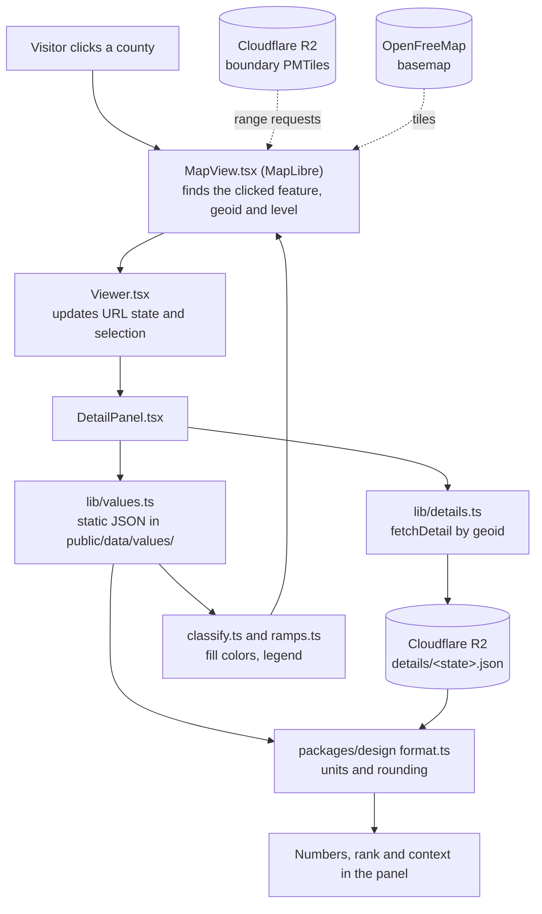

# Architecture map

Where things live and how they connect. Rules and commands: `docs/handbook.md`. Full spec: `docs/SPEC.md`.

Mapwich has two halves. An **offline pipeline** (`data/`) runs on Robbie's machine and turns public
sources into tiles and JSON. The **website** (`apps/web`) only reads what the pipeline published.

## Where things live

| Path | What it is |
| --- | --- |
| `apps/web/` | The Next.js site. `src/app/` routes: `/` (map), `/data` and `/data/[id]` (dataset directory and profiles), `/place/[geoid]`, `/specials/*` (editorial pieces, Odd Pairings, private `/specials/review`), `/api/keepalive`, `/api/specials/revalidate`. |
| `apps/web/src/components/` | `Viewer.tsx` is the map page's brain (URL state, panels, table, search). `map/MapView.tsx` is the only file that touches MapLibre. `map-page/` holds the panels, legend and hover popups. |
| `apps/web/src/lib/` | Loaders and helpers: `values.ts` (load and classify values), `registry.ts`, `url-state.ts`, `details.ts` (click details and place geography from static files), `supabase.ts`, `search.ts`, `specials.ts`, `approvals.ts`, `insights.ts`. |
| `apps/web/src/generated/`, `apps/web/public/data/` | Output of the ingest `exportweb` step: registry, glossary and insights JSON plus per-dataset value files. Don't hand-edit. |
| `apps/web/content/` | Markdown for Specials. `apps/web/e2e/` holds the Playwright tests. `apps/web/scripts/prepare.mts` runs before dev and build. |
| `packages/design/` | Every visual decision: `ramps.ts`, `classify.ts`, `format.ts`, `sizing.ts` (zoom bands per geography level), `themes.ts` (light and dark tokens), `style.ts` (basemap and data-layer styles), shared React components. `scripts/check.ts` is the contrast gate. Docs render to `docs/design-system.md`. |
| `data/registry/` | The single source of truth for datasets: `datasets/*.yaml`, `schema.ts` (zod), `glossary.yaml`, `timeline.ts`, `load.ts`. |
| `data/ingest/src/` | `run.ts` dispatches steps (`npm run ingest -- <step>`). One file per source kind (`acs`, `places`, `climdiv`, `lodes`, `nbi`, `fars`, `vmt`, `cejst`, `ddp287g`, `features`), plus `geographies`, `tiles`, `publish-tiles`, `exportweb`, `insights`, `validate`. |
| `supabase/migrations/` | SQL for the hosted Postgres/PostGIS database (datasets, geographies, dataset values, insights, reviewers, insight reviews). Applied with `npm run db:migrate`. |
| `scripts/` | `merge-pr.sh` (the only merge path), `db-push.sh`, `check-decisions.mjs`, `test-guardrails.mjs`. |
| `.claude/` | `agents/` (lead, data-scout), `skills/`, `hooks/guardrails.mjs`, `settings.json`. |
| `docs/` | `SPEC.md`, `branching.md`, `data-intake.md`, `data-sources.md`, `roadmap.md`, `decisions/` (D-100 and up), `DECISIONS.md` (frozen D-01 to D-99). |

How the pieces depend on each other: `data/registry` defines datasets. `data/ingest` reads the
registry and writes the database, the JSON and the tiles. `apps/web` reads the registry, the
JSON and the tiles, and styles everything through `packages/design`.

## Services

| Service | Role |
| --- | --- |
| **Vercel** | Hosts the site. Deploys `main` to production and makes a preview per PR. A daily cron hits `/api/keepalive` (`apps/web/vercel.json`) so Supabase doesn't pause. |
| **Supabase** (Postgres + PostGIS) | The ingest pipeline's working store (state and county values, geographies), Odd Pairing approvals, reviewer sign-in, and tract geography on tract place pages. Visitors' state and county clicks and place pages no longer query it (D-198): they read `details/<state>.json` on R2. Free tier (500 MB), so tract values are static files instead. |
| **Cloudflare R2** | Hosts the boundary and feature PMTiles, block-group values (D-124) and state/county click details (`details/<state fips>.json`, D-198). The browser fetches them with HTTP range requests; there is no tile server. Base URL is `NEXT_PUBLIC_TILES_BASE_URL`. Published by `ingest publish-tiles`. |
| **OpenFreeMap** | The free vector basemap (streets, labels), styled by `packages/design/src/style.ts`. |
| **GitHub** | Issues board, PRs, `pr-checks.yml` (branch up to date, decision numbers). |

## From a click to numbers on screen

A visitor clicks a county. The shape comes from R2 tiles, the colors and the number from static
JSON, and the details panel adds every dataset's value for that place from one static file per
state on R2 (D-198).

Steps in words:

1. MapLibre (only in `MapView.tsx`) draws the basemap from OpenFreeMap and the county boundaries
   from R2 PMTiles. Colors come from joining each feature's geoid to the loaded values.
2. On click, `MapView` reports the feature to `Viewer.tsx`, which updates the URL (`?d`, `b`, `at`, `lv`, `t`).
3. `DetailPanel.tsx` shows the value from the static files and fetches the rest by geoid from
   `details/<state fips>.json` on R2 (states and counties) or `values/tracts/<county>.json` (tracts).
4. `packages/design` formats every number and picks every color, so the legend, popup and map agree.

## How data gets in

`data/registry/datasets/<id>.yaml` -> `npm run ingest -- <step>` (Robbie's machine) -> Supabase
rows, generated JSON under `apps/web/` and PMTiles on R2 -> PR -> merge -> Vercel deploy. After any
step that changes state or county values, run `ingest -- details` then `ingest -- publish-details`
so the click details on R2 match (D-198).
See the `add-dataset` and `build-tiles` skills.
