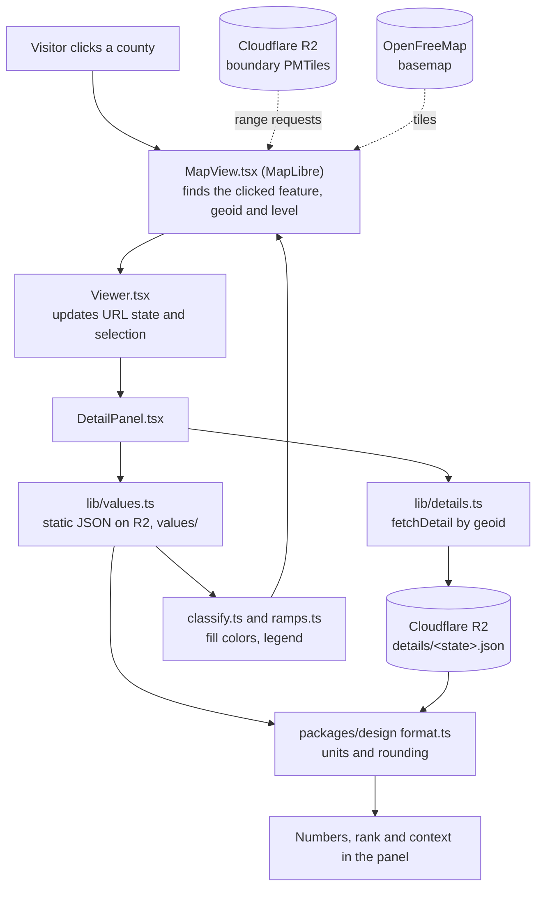

# Architecture map

Where things live and how they connect. Rules and commands: `docs/handbook.md`. Full spec: `docs/SPEC.md`.

Mapwich has two halves. An **offline pipeline** (`data/`) runs on Robbie's machine and turns public
sources into tiles and JSON. The **website** (`apps/web`) only reads what the pipeline published.

## Where things live

| Path | What it is |
| --- | --- |
| `apps/web/` | The Next.js site. `src/app/` routes: `/` (splash), `/map` (the map), `/compare/[a]/[b]` (two places side by side), `/data` and `/data/[id]` (dataset directory and profiles), `/place/[geoid]`, `/specials/*` (editorial pieces, Odd Pairings, private `/specials/review`), `/og/*` (link-preview cards for home, places, datasets and specials), `/api/keepalive`, `/api/specials/revalidate`. |
| `apps/web/src/components/` | `Viewer.tsx` is the map page's brain (URL state, panels, table, search). `map/MapView.tsx` is the only file that touches MapLibre. `map-page/` holds the panels (datasets, filters and "Map options", detail, "Why this matters" in `ContextPanel.tsx`), legend, hover popups and the hooks that feed them (`useViewerData`, `useChangeMoes`, `useUnreliable`). `compare/` is the compare-places page. `specials/` renders a Special and its inline maps, charts and tables. `ui/` is the shadcn `button` and `input` only. Also here: `CsvDownload.tsx`, `ShareButton.tsx`, `DataTable.tsx`, `PlaceProfile.tsx`. |
| `apps/web/src/lib/` | Loaders and helpers: `values.ts` (load and classify values; `values.worker.ts` does it off the main thread for block groups, D-277), `change.ts` (change maps between two timeline stops), `compare.ts` (compare route, level rules, test of a difference), `reliability.ts` (unreliable-estimate flags, D-222), `csv.ts` (CSV built in the browser), `context.ts` and `context-load.mts` ("Why this matters"), `share-meta.ts` and `og-card.tsx` (link previews), `special-blocks.mts` and `specials-load.mts` (Specials), `registry.ts`, `url-state.ts`, `details.ts` (click details and place geography from static files), `static-files.ts` (the tiles base every data file is read from, D-210), `supabase.ts`, `search.ts`, `specials.ts`, `approvals.ts`, `insights.ts`. |
| `apps/web/src/generated/` | Output of the ingest `exportweb` step, committed: registry, glossary, periods, insights and county names (`names.json`). `context.json` and `specials.json` come from `apps/web/scripts/prepare.mts`, not ingest. Don't hand-edit. |
| `data/tiles/` (git-ignored) | Everything the browser reads beside the code, uploaded to R2: PMTiles, `values/` (every dataset and level), `geo/` (names, map points, search, tract geography) and `details/`. Locally `apps/web/public/tiles` links here (D-210). |
| `apps/web/content/` | `specials/` (Markdown for Specials; format in its `README.md`) and `context/` (one YAML per dataset for "Why this matters"; shows only when `approved`, D-279). `apps/web/e2e/` holds the Playwright tests (`*.tests.mjs` suites, `menus.spec.mjs`). `apps/web/scripts/prepare.mts` runs before dev and build. |
| `packages/design/` | Every visual decision: `ramps.ts`, `classify.ts`, `format.ts`, `sizing.ts` (zoom bands per geography level), `themes.ts` (light and dark tokens), `style.ts` (basemap and data-layer styles), shared React components. `scripts/check.ts` is the contrast gate. Docs render to `docs/design-system.md`. |
| `data/registry/` | The single source of truth for datasets: `datasets/*.yaml`, `schema.ts` (zod), `glossary.yaml`, `timeline.ts`, `load.ts`, `relations.yaml` + `relations.ts` (topic groups, the counts behind each map, parts-of-a-whole sets; `registry:validate` fails if a map has no entry, D-257). |
| `data/ingest/src/` | `run.ts` dispatches steps (`npm run ingest -- <step>`). One file per source kind (`acs`, `places`, `climdiv`, `lodes`, `nbi`, `fars`, `vmt`, `cejst`, `ddp287g`, `overdose`, `airquality`, `nri`, `lead`, `features`), plus `geographies`, `tiles`, `publish-tiles` (also `publish-data`, `publish-counts`), `counts` (counts and margins of error behind each map, D-257), `details`, `exportweb`, `insights`, `validate`. |
| `supabase/migrations/` | SQL for the hosted Postgres/PostGIS database (datasets, geographies, dataset values, insights, reviewers, insight reviews). Applied with `npm run db:migrate`. |
| `scripts/` | `merge-pr.sh` (the only merge path), `db-push.sh`, `check-decisions.mjs`, `test-guardrails.mjs`, `brief.mjs` (the session brief: open work, datasets, decisions, hot spots, built fresh each run; `node scripts/brief.mjs <issue>` for one task), `check-special-numbers.mts` (a Special's numbers against the data), `bench-block-groups.mts`, `lighthouse-summary.mjs`. |
| `.claude/` | `agents/` (lead, data-engineer, ui-engineer, editor, data-scout, review-lead, tester; the tester's trial is D-291), `skills/`, `hooks/guardrails.mjs`, `settings.json`. |
| `docs/` | `SPEC.md`, `branching.md`, `data-intake.md`, `data-sources.md`, `roadmap.md`, `decisions/` (D-100 and up), `DECISIONS.md` (frozen D-01 to D-99). |

How the pieces depend on each other: `data/registry` defines datasets. `data/ingest` reads the
registry and writes the database, the JSON and the tiles. `apps/web` reads the registry, the
JSON and the tiles, and styles everything through `packages/design`.

## Services

| Service | Role |
| --- | --- |
| **Vercel** | Hosts the site. Deploys `main` to production and makes a preview per PR. A daily cron hits `/api/keepalive` (`apps/web/vercel.json`) so Supabase doesn't pause. |
| **Supabase** (Postgres + PostGIS) | The ingest pipeline's working store (state and county values, geographies), Odd Pairing approvals and reviewer sign-in. Visitors' map, clicks and place pages never query it (D-198, D-210): they read static files on R2. Free tier (500 MB), so tract values are static files instead. |
| **Cloudflare R2** | Hosts the boundary and feature PMTiles, every value file (`values/<id>/[<stop>/]<level>.json`, `values/tracts/<county>.json`; D-124, D-210), margins of error and the counts behind each map (generated per dataset beside the value files, not checked in: `<level>.moe.json`, `<level>.counts.json`, `us.json`, plus `values/counts/<level>/<county>.json`; D-257), `geo/` (names, map points, search, tract geography) and state/county click details (`details/<state fips>.json`, D-198). PMTiles are read with HTTP range requests; there is no tile server. Base URL is `NEXT_PUBLIC_TILES_BASE_URL`. Published by `ingest publish-tiles` (PMTiles) and `ingest publish-data` (JSON, one-hour cache). |
| **OpenFreeMap** | The free vector basemap (streets, labels), styled by `packages/design/src/style.ts`. |
| **GitHub** | Issues board, PRs, `pr-checks.yml` (branch up to date, decision numbers). |

## From a click to numbers on screen

A visitor clicks a county. The shape comes from R2 tiles, the colors and the number from static
JSON, and the details panel adds every dataset's value for that place from one static file per
state on R2 (D-198).

Steps in words:

1. MapLibre (only in `MapView.tsx`) draws the basemap from OpenFreeMap and the county boundaries
   from R2 PMTiles. Colors come from joining each feature's geoid to the loaded values.
2. On click, `MapView` reports the feature to `Viewer.tsx`, which updates the URL (`?d`, `b`, `at`, `lv`, `t`).
3. `DetailPanel.tsx` shows the value from the static files and fetches the rest by geoid from
   `details/<state fips>.json` on R2 (states and counties) or `values/tracts/<county>.json` (tracts, also on R2).
4. `packages/design` formats every number and picks every color, so the legend, popup and map agree.

## How data gets in

`data/registry/datasets/<id>.yaml` -> `npm run ingest -- <step>` (Robbie's machine) -> Supabase
rows, value files in `data/tiles/` and generated JSON in `apps/web/src/generated/` ->
`ingest -- publish-data` (values, geo and details to R2) -> PR -> merge -> Vercel deploy. A refresh
of an existing dataset needs only the upload, no deploy (D-210). After any step that changes state
or county values, run `ingest -- details` before the upload so the click details match (D-198).
See the `add-dataset` and `build-tiles` skills.
