# Cartographic design system

> Generated by `npm run docs -w @webgis/design` from `packages/design`. Don't edit by hand; change the tokens and re-run.

Every map layer gets its symbology from **its registry entry + these tokens**. There is no per-layer styling anywhere in the app (CLAUDE.md). The pieces:

| Module | What it holds |
|---|---|
| `src/ramps.ts` | Color ramps (sequential, diverging, categorical, bivariate), interpolated in OKLab to the requested class count |
| `src/classify.ts` | Classification: quantile, equal interval, Jenks (Ckmeans), manual |
| `src/themes.ts` | Light and dark UI + basemap colors, and the contrast rules they must pass |
| `src/sizing.ts` | Geography-level zoom bands, line/point sizes by zoom, label rules, motion |
| `src/format.ts` | Number formatting per unit, legend rules |
| `src/style.ts` | The basemap style and the thematic layer stack, both built only from the above |
| `src/components/` | The one Legend (+ bivariate legend), one Popup, one loading/empty/error StatusState |

## The accessibility gate

`npm run check:design` runs before every build (`npm run build`) and **fails the build** on any violation. It simulates protanopia, deuteranopia and tritanopia at full severity (Machado et al. 2009) and measures color difference with CIEDE2000:

- **Sequential / diverging:** every adjacent pair of classes ≥ 5 ΔE under all four visions, at every certified class count; sequential lightness strictly monotonic; diverging lightness peaks at the midpoint.
- **Categorical:** every pair ≥ 10 ΔE.
- **Bivariate:** every pair of the 9 cells ≥ 8 ΔE.
- **Contrast:** WCAG ratios for text, labels and focus rings in both themes (table below).

Thresholds are logged as decision D-12. The rows in each example below are the same classes as seen with normal vision, then with each simulated deficiency.

## Ramps

### Blues (`blues`) · sequential, 3–7 classes

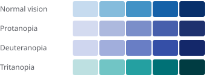

Source: ColorBrewer 2.0 (Brewer, Penn State). Worst-case adjacent-class ΔE2000 across certified class counts: Normal vision **6.1** · Protanopia **5.5** · Deuteranopia **6.2** · Tritanopia **6.8**.

### Yellow–Green–Blue (`ylgnbu`) · sequential, 3–6 classes

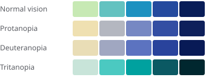

Source: ColorBrewer 2.0. Worst-case adjacent-class ΔE2000 across certified class counts: Normal vision **12.1** · Protanopia **7.5** · Deuteranopia **10.0** · Tritanopia **12.7**.

### Oranges (`oranges`) · sequential, 3–7 classes

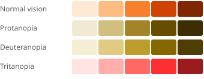

Source: ColorBrewer 2.0. Worst-case adjacent-class ΔE2000 across certified class counts: Normal vision **9.9** · Protanopia **8.3** · Deuteranopia **9.0** · Tritanopia **7.8**.

### Purples (`purples`) · sequential, 3–7 classes

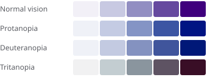

Source: ColorBrewer 2.0. Worst-case adjacent-class ΔE2000 across certified class counts: Normal vision **6.4** · Protanopia **6.3** · Deuteranopia **6.2** · Tritanopia **5.4**.

### Viridis (`viridis`) · sequential, 3–7 classes

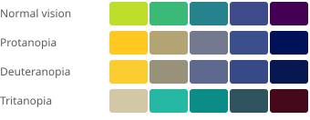

Source: matplotlib viridis (van der Walt & Smith). Worst-case adjacent-class ΔE2000 across certified class counts: Normal vision **12.7** · Protanopia **11.4** · Deuteranopia **7.8** · Tritanopia **7.3**.

### Cividis (`cividis`) · sequential, 3–7 classes

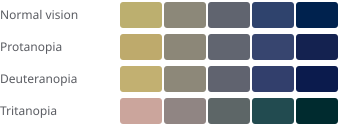

Source: Nuñez, Anderton & Renslow 2018 (CVD-optimized). Worst-case adjacent-class ΔE2000 across certified class counts: Normal vision **8.5** · Protanopia **9.1** · Deuteranopia **8.9** · Tritanopia **8.4**.

### Red–Blue (`rdbu`) · diverging, 3–7 classes

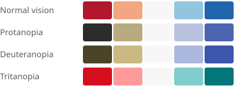

Source: ColorBrewer 2.0. Worst-case adjacent-class ΔE2000 across certified class counts: Normal vision **13.3** · Protanopia **10.7** · Deuteranopia **12.9** · Tritanopia **16.5**.

### Orange–Purple (`puor`) · diverging, 3–7 classes

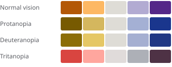

Source: ColorBrewer 2.0. Worst-case adjacent-class ΔE2000 across certified class counts: Normal vision **14.5** · Protanopia **13.5** · Deuteranopia **13.8** · Tritanopia **10.0**.

### Brown–Teal (`brbg`) · diverging, 3–7 classes

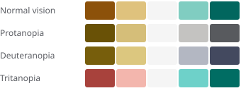

Source: ColorBrewer 2.0. Worst-case adjacent-class ΔE2000 across certified class counts: Normal vision **16.2** · Protanopia **5.9** · Deuteranopia **8.6** · Tritanopia **15.3**.

### Okabe–Ito (`okabeIto`) · categorical, 2–8 classes

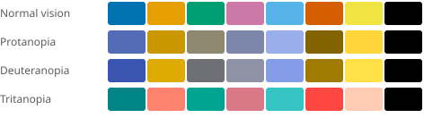

Source: Okabe & Ito 2008, Color Universal Design. Worst-case any-pair ΔE2000 across certified class counts: Normal vision **21.7** · Protanopia **12.9** · Deuteranopia **13.3** · Tritanopia **10.6**.

### Bivariate blue × gold (`bivBlueGold`) · bivariate, 9–9 classes

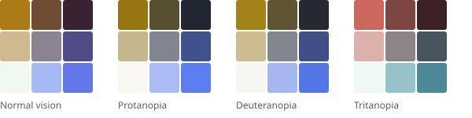

Source: Project-generated: bilinear OKLab grid searched to maximize the closest pair under protan/deutan/tritan simulation (min ΔE2000 16.6). Stevens' blue-pink failed protan (5.9).. Worst-case any-pair ΔE2000 across certified class counts: Normal vision **19.7** · Protanopia **18.7** · Deuteranopia **18.3** · Tritanopia **16.6**.

### Why the bivariate palette is home-made
None of the published 3×3 bivariate schemes tested passed all three simulated deficiencies (Stevens' blue–pink failed protanopia at 5.9). `bivBlueGold` is a bilinear OKLab grid whose corners were searched to maximize the closest pair under every simulation. Read it as blue = first dataset high, gold = second dataset high, dark = both high.

## Themes

Light and dark come from the same token structure; the basemap and the UI chrome both read them (as CSS variables via `themeCssVars`, and directly in `basemapStyle`).

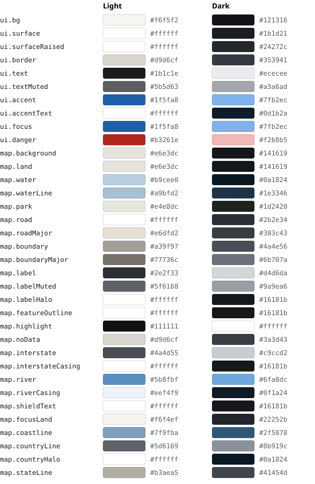

| Theme | Purpose | Pair | Ratio | Required |
|---|---|---|---|---|
| light | body text | `text` on `bg` | 15.64 | 7 |
| light | panel text | `text` on `surface` | 17.05 | 7 |
| light | secondary text | `textMuted` on `surface` | 6.58 | 4.5 |
| light | secondary text on page | `textMuted` on `bg` | 6.04 | 4.5 |
| light | links and accent text | `accent` on `surface` | 6.44 | 4.5 |
| light | text on accent buttons | `accentText` on `accent` | 6.44 | 4.5 |
| light | focus ring (non-text) | `focus` on `surface` | 6.44 | 3 |
| light | panel borders (decorative) | `border` on `surface` | 1.45 | 1.3 |
| light | map labels | `map.label` on `map.labelHalo` | 13.37 | 7 |
| light | minor map labels | `map.labelMuted` on `map.labelHalo` | 6.18 | 4.5 |
| light | selection outline (non-text) | `map.highlight` on `map.land` | 14.73 | 3 |
| light | interstate line vs its casing (non-text, reads over any fill) | `map.interstate` on `map.interstateCasing` | 8.45 | 4.5 |
| light | river line vs its casing (non-text) | `map.river` on `map.riverCasing` | 3.09 | 3 |
| light | interstate route number text | `map.shieldText` on `map.interstate` | 8.45 | 4.5 |
| light | national boundary vs U.S. land (non-text) | `map.countryLine` on `map.focusLand` | 5.65 | 3 |
| light | shoreline vs water (decorative) | `map.coastline` on `map.water` | 1.71 | 1.5 |
| dark | body text | `text` on `bg` | 15.75 | 7 |
| dark | panel text | `text` on `surface` | 14.30 | 7 |
| dark | secondary text | `textMuted` on `surface` | 6.92 | 4.5 |
| dark | secondary text on page | `textMuted` on `bg` | 7.62 | 4.5 |
| dark | links and accent text | `accent` on `surface` | 7.62 | 4.5 |
| dark | text on accent buttons | `accentText` on `accent` | 7.85 | 4.5 |
| dark | focus ring (non-text) | `focus` on `surface` | 7.62 | 3 |
| dark | panel borders (decorative) | `border` on `surface` | 1.46 | 1.3 |
| dark | map labels | `map.label` on `map.labelHalo` | 12.22 | 7 |
| dark | minor map labels | `map.labelMuted` on `map.labelHalo` | 6.62 | 4.5 |
| dark | selection outline (non-text) | `map.highlight` on `map.land` | 18.13 | 3 |
| dark | interstate line vs its casing (non-text, reads over any fill) | `map.interstate` on `map.interstateCasing` | 11.05 | 4.5 |
| dark | river line vs its casing (non-text) | `map.river` on `map.riverCasing` | 6.96 | 3 |
| dark | interstate route number text | `map.shieldText` on `map.interstate` | 11.05 | 4.5 |
| dark | national boundary vs U.S. land (non-text) | `map.countryLine` on `map.focusLand` | 4.85 | 3 |
| dark | shoreline vs water (decorative) | `map.coastline` on `map.water` | 2.38 | 1.5 |

## Classification and legends

- Default: **quantile**, 5 classes; each registry entry can override method and class count within the ramp's certified range.
- Breaks are computed **per geography level** (state, county and tract each get their own), so the legend always describes what's on screen. Its caption names the level.
- Class labels are text (`< a`, `a – b`, `≥ z`), so the legend never relies on color alone.
- "No data" is always shown, with a hatched swatch, so a gap never reads as a low value.
- **Skewed data:** when quantile breaks would land on the minimum (e.g. most tracts at exactly 0% transit commuting), the bottom class becomes "exactly the minimum" (labeled "0%") and the other classes are quantiles of the values above it. This avoids an empty "< 0%" class.
- Bivariate maps use tertiles on each axis; cell = 3 · y + x.

## Geography levels and zoom

| Level | Shown at zoom |
|---|---|
| State | 0 – 3 |
| County | 3 – 8.5 |
| Census tract | 8.5 – max |

Line widths and outlines scale with zoom (`SIZE`: featureOutline, highlightOutline, highlightCasing, line, lineMajor, point, dataLine, interstate, interstateCasing, river, riverCasing, pointStroke). Labels use Noto Sans Regular with a 1.4px halo that matches the basemap tone. Thematic fills are inserted **below** the basemap's label layers, so place names stay readable over any fill.

## Motion and accessibility

- `prefers-reduced-motion` turns off map fades and UI animation.
- Map canvas has an ARIA label naming the dataset(s) and level; every control is a real button or link with a visible focus ring (`ui.focus`).
- Feature details are available as text (popup, detail panel, and the table view), not only as color.
